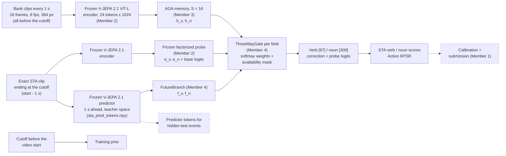

# Member 4: future prediction and the three-way gate

Status for the 13 November mid-term. Solid boxes run in the team pipeline; dashed boxes are
future work.



## Results so far

1. **Predictor feasibility (done, 6 November).** The frozen V-JEPA 2.1 ViT-L/384 predictor runs
   with the team's checkpoint and input format (16 frames, 8 fps, 384 px): checkpoint keys match,
   outputs are finite, our `anticipate` equals the official `AnticipativeWrapper` (max difference
   0.0), no decoded frame is after the cutoff, and predictions vary across events (mean
   cross-event cosine 0.81). Details: [MEMBER4_VSC_RESULTS.md](MEMBER4_VSC_RESULTS.md).
   Caveat: the distilled student predicts the ViT-G teacher's features, so predicted tokens are
   not in the encoder's space and cannot be scored against encoder tokens directly.
2. **Predictor tokens for all events (Member 2).** The extractor stores 24 predictor tokens per
   STA event (`sta_pred_tokens.npy`, 67,217 events). Member 2's probe on these tokens scores
   7.23 Action MT5R against 7.63 for the observed clip alone.
3. **Future branch in the full model (this work).** The predictor tokens now feed the third input
   of the three-way gate inside Member 3's STA memory model, and gate branches can be switched
   off for ablations. Results (3 seeds, [MEMBER4_GATE_ABLATION.md](MEMBER4_GATE_ABLATION.md)):
   with Member 2's frozen predictor pooling the future branch gives **8.20 ± 0.10 Action MT5R,
   +0.20 ± 0.07 over history + present** (gain on every seed); the plain mean of the predictor
   tokens gives no gain (-0.04), and switching history off changes nothing (+0.02), because the
   gate puts ≥ 0.98 of its weight on a single branch.

## The future branch

`epic_starter/models/future_branch.py`, `FutureBranch(feat_dim, d, encoder)`:
`[B, 24, D]` predictor tokens and a `[B]` availability mask in, `(f_v, f_n)` `[B, d]` out, which is
what `GatedAGAModel(future=...)` takes.

The 24 stored tokens are not all predicted (see `pool_predicted_24_tokens` in
`scripts/extract_vjepa21_tokens.py`): tokens 0-6 are the last seven *observed* temporal means,
copied from the encoder; token 7 is the predicted temporal mean and tokens 8-23 the predicted
4x4 grid, 1 s after the cutoff.

| `--future-encoder` | What it reads | Trainable |
|---|---|---|
| `mean` | mean of the 17 predicted tokens (7-23) | LayerNorm + Linear per field |
| `probe` | Member 2's `factorized_pred` predictor pathway (its pred pools + LayerNorms, all 24 tokens), from `STA_factorized_pred/best.pt` | projection only with `--freeze-future` |

`mean` uses nothing but the predictor's output, so it measures what the predictor adds; `probe`
uses a pooling that Member 2 already trained on these tokens. Both learn their own projection
into the gate, so the teacher feature space does not need to match the encoder's.

The future branch is **available** only for events whose exact STA clip was extracted (the same
rule and leakage check as the present clip: `Anchors(..., tokens_file="sta_pred_tokens.npy")`) and
whose token block is not all zeros. Elsewhere the gate gives it weight 0.

## Gate ablation

Every row is Member 3's best setting (decoupled memory, S = 16, Member 2's STA probe frozen as the
present encoder, validation split `split_seed42`), with the three-way gate. Only the branches the
gate may use change, three seeds each (42, 1, 2):

| Row | `train_sta_memory.py` options | Question |
|---|---|---|
| P | `--fusion three_way --branches present` | the "history switched off" control Member 3 asked for |
| H+P | `--fusion three_way` | Member 3's `_3way` row (reused) |
| P+F | `--fusion three_way --branches present,future --future-encoder mean` | does the predictor help without memory? |
| H+P+F | `--fusion three_way --future-encoder mean` | does it add anything on top of memory? |
| H+P+F (probe) | `... --future-encoder probe --future-init STA_factorized_pred/best.pt --freeze-future` | same with Member 2's trained pooling |

```bash
for seed in 42 1 2; do
  sbatch -A "$EPIC_ACCOUNT" -o "$EPIC_PROJECT/logs/m4-gate-%A_%a.out" scripts/member4_gate_ablation.slurm $seed
done
python scripts/member4_gate_summary.py --runs-dir "$EPIC_TEAM/results/sta_memory" \
    --out "$EPIC_TEAM/results/member4/gate_ablation.md"
```

Runs are written to `$EPIC_TEAM/results/sta_memory/decoupled_S16_seed<seed>_3way*` with the usual
files; `val_outputs.npz` also holds `future_available` and the gate weights, so
`member4_gate_summary.py` reports the mean weight per branch next to the scores. The comparison
that matters is the change against H+P **with the same seed**.

## Gate-collapse fixes (team plan, Spec 5)

In every gate ablation the gate put about 1.0 of its weight on one branch (present, or future with
Member 2's pooling): the branch with the lowest residual loss at the start wins and the others stop
getting gradient. Three options of `train_sta_memory.py --fusion three_way` (all off by default; the
probe's base logits stay outside the gate, untouched):

| Option | What it does |
|---|---|
| `--gate-dropout p` | training only: a row with history loses, with probability p, its present branch, its future branch or both (one of the three at random). History is never dropped, so the gate must learn to use it; this also trains the H+P fallback for test events without predictor tokens. |
| `--gate-entropy λ` | adds −λ × (mean gate entropy, verb and noun) to the loss: a spread-out gate costs less. |
| `--gate-uncertainty` | the gate also reads the normalised entropy of the frozen probe's verb and noun predictions, [u_v, u_n] in [0, 1], so it can lean on history / future when the present clip is ambiguous. |

The history branch is warm-started with Member 3's options (`--memory-init <..._psteps_memonly>/best.pt
--freeze-memory --step-features <probe steps>`).

**Member 2's hybrid-v3 probes as the future branch.** `--future-encoder probe --future-init <best.pt>`
reads the checkpoint's mode and uses that probe's own predictor pathway and token file:

| Member 2's probe | Predictor tokens | Pathway in `FutureBranch` |
|---|---|---|
| `factorized_pred` | `sta_pred_tokens.npy` [24, 1024] | pred pools + `ln_pred_*` |
| `pred_17_only` | `sta_pred17_1664.npy` [17, 1664] | `pred_teacher_proj` + pred pools + `norm_*` (strict future) |
| `factorized_pred_1664` | `sta_pred17_1664.npy` [17, 1664] + 7 observed tokens of the present clip | `obs_ctx_adapter` + `pred_teacher_proj` + pred pools + `ln_pred_*` |

Hidden-test events are read from the matching test files (`test_events_index.csv` +
`sta_pred_test_tokens.npy` / `sta_pred17_1664_test.npy`, from `scripts/extract_pred1664_and_test.py`)
with the same leakage check, so the future branch is available on the hidden test too.
`--future-encoder mean --future-tokens <file>` averages any predictor-only file.

`scripts/member4_gate_fix.slurm` runs ten rows per seed on the hybrid-v3 split (memory seed s with
Member 2's probe seed s): the factorized_pred future branch without fix, with each fix and with all
three; history + present with all three; pred_17_only and factorized_pred_1664 without and with all
three fixes. It needs Member 3's hybrid-v3 probe steps and stage-1 memories (paths in its header).

```bash
for s in 42 1 2; do
  sbatch -A "$EPIC_ACCOUNT" -o "$EPIC_PROJECT/logs/m4-fix-%A_%a.out" scripts/member4_gate_fix.slurm $s
done
python scripts/member4_gate_summary.py --runs-dir "$EPIC_TEAM/results/sta_memory_hybrid-v3" \
    --out "$EPIC_TEAM/results/member4/gate_fix.md" \
    --reference "three_way H+P+F (future: probe) [memory probe steps, pre-trained (frozen)]"
```

## Limits and future work

- **Hidden test.** Since 22/11 Member 2 also extracts the hidden-test events (separate `*_test*`
  files); the future branch reads them. The present branch still reads only `sta_obs_tokens.npy`, so
  on the hidden test it falls back to the last bank clip until the present anchors also read
  `sta_obs_test_tokens.npy` (Member 3's predict-only mode); `factorized_pred_1664` takes its 7
  observed tokens from that same present clip.
- The gate is trained with the future branch available for almost every event; if test events
  stay without it, `--gate-dropout` (above) trains the history + present fallback as well.
- Only one horizon (1 s after the cutoff, i.e. the action start) and one backbone (V-JEPA 2.1
  ViT-L/384, selected by the team) are tested. Several horizons, or a predictor in the encoder's
  own feature space, would allow a direct fidelity check, which this project does not do.
- CPU runs on wICE; numbers are validation scores on our split, not test-server scores.

## Code map

| Piece | File | Tests |
|---|---|---|
| Three-way gate and verb/noun head | `epic_starter/models/gate.py` | `tests/test_gate.py` |
| Future branch | `epic_starter/models/future_branch.py` | `tests/test_future_branch.py` |
| Wiring (gate inputs, branch mask) | `GatedAGAModel` in `epic_starter/models/aga.py`, `HistoryDataset(future=...)` | `tests/test_future_branch.py` |
| Training options | `scripts/train_sta_memory.py` (`--future-encoder`, `--future-init`, `--freeze-future`, `--future-tokens`, `--branches`, `--gate-dropout`, `--gate-entropy`, `--gate-uncertainty`) | `tests/test_future_branch.py` |
| Gate-collapse fixes | `drop_branches`, `normalised_entropy` in `aga.py`; `gate_entropy`, `mean_gate_entropy`, `extra_dim` in `gate.py` | `tests/test_future_branch.py` |
| Ablation jobs and summary | `scripts/member4_gate_ablation.slurm`, `scripts/member4_gate_fix.slurm`, `scripts/member4_gate_summary.py` (`--reference`) | `tests/test_future_branch.py` |
| Encoder + predictor in one pass | `epic_starter/models/future_latent.py` (`anticipate`) | `tests/test_future_latent.py` |
| Predictor feasibility check | `scripts/predictor_feasibility.py`, `scripts/member4_feasibility.slurm` | `tests/test_future_latent.py` |
| Synthetic gate demo | `scripts/gate_demo.py` | |

Gate interface: `ThreeWayGate(in_dim)(history, present, future, available)` takes three `[B, in_dim]`
tensors and an optional bool `[B, 3]` mask (history, present, future). It returns the fused vector and
the gate weights `[B, 3]`. Unavailable branches get weight 0 even if they hold NaN; rows with no branch
return zeros and must use the prior. `GatedVerbNounHead` returns `verb_logits [B, 97]`,
`noun_logits [B, 300]` and the gate weights per field.
