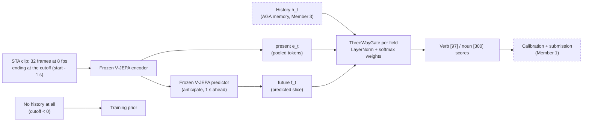

# Member 4: future prediction and the three-way gate

Status for the 7 November integration checkpoint. Solid boxes run today; dashed boxes are
planned and depend on other members' outputs.



## What runs now

| Piece | File | How to try it |
|---|---|---|
| Three-way gate and verb/noun head | `epic_starter/models/gate.py` | `python scripts/gate_demo.py` (synthetic vectors, CPU) |
| Encoder + predictor in one pass | `epic_starter/models/future_latent.py` (`anticipate`) | used by the feasibility check; reusable for feature extraction |
| Predictor feasibility check | `scripts/predictor_feasibility.py` | `--backend dummy` locally; real checkpoints via the Slurm job below |
| Tests | `tests/test_gate.py`, `tests/test_future_latent.py` | `python -m pytest tests -q` on a compute node |

Gate interface: `ThreeWayGate(in_dim)(history, present, future, available)` takes three `[B, in_dim]`
tensors and an optional bool `[B, 3]` mask (history, present, future). It returns the fused vector and
the gate weights `[B, 3]`. Unavailable branches get weight 0 even if they hold NaN; rows with no branch
return zeros and must use the prior. `GatedVerbNounHead` returns `verb_logits [B, 97]`,
`noun_logits [B, 300]` and the gate weights per field.

## Feasibility check

`anticipate` reproduces the official `AnticipativeWrapper.forward` (vjepa2,
`evals/action_anticipation_frozen`) and the script checks that both give the same output. For each
sampled STA event it reports:

- whether the model loads and runs on our clips, output shapes, finite values and seconds per clip;
- that the latest decoded frame is not after the cutoff;
- whether predictions differ across events (mean cosine between events; close to 1 means collapse);
- a fidelity proxy, only when predictor and encoder share a feature space: predict the **last
  observed slice** (which ends at the cutoff) from a context that stops 0 s or 1 s earlier, and
  compare with the encoder's tokens for that slice, against copying the last context slice
  (persistence). Every frame used is before the cutoff, so this check cannot leak.

Distilled V-JEPA 2.1 students (ViT-B/L "dist_vitG") predict the ViT-G teacher's features (1664
channels for ViT-L), not their own; the official wrapper slices them to 1024 channels. The fidelity
proxy is skipped for them and is run on the non-distilled V-JEPA 2 ViT-L/256 instead.

Run on VSC (CPU job, about 30 minutes plus the first download of two 5 GB checkpoints):

```bash
sbatch -M wice -A "$EPIC_ACCOUNT" -o "$EPIC_PROJECT/logs/m4-feasibility-%j.out" scripts/member4_feasibility.slurm
```

The job clones vjepa2 into `team/code/vjepa2`, downloads the checkpoints into
`team/checkpoints/pretrained/`, runs the tests and both backbones, and writes
`team/results/member4/feasibility_<backbone>_<time>.json`.

## Limits and next steps

- Preprocessing follows our pipeline (full frame resized to a square); the official evaluation
  centre-crops. Use whatever the team fixes for the baseline.
- Timings are CPU numbers; GPU timings come with the first training job.
- Next: connect `f_t` from cached predictor tokens (blueprint §4.3) and `e_t` from Member 2's probe
  to `GatedVerbNounHead`, then add `h_t` from Member 3's memory.


## Selected execution scope (2026-11-06)

The owner selected only V-JEPA 2.1 distilled ViT-L/384, at 16 frames and 8 fps.
Earlier references to running two backbones are superseded. No V-JEPA 2/256
run is requested. Direct predictor-versus-student-encoder fidelity remains
unvalidated; the selected run measures execution, wrapper equivalence,
finite outputs and cross-event feature variation, followed by the gate demo.
