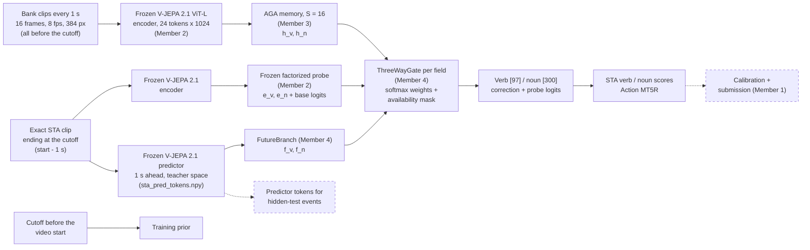

# Member 4: future prediction and the three-way gate

Status for the 13 November mid-term. Solid boxes run in the team pipeline; dashed boxes are
future work.



## Results so far

1. **Predictor feasibility (done, 6 November).** The frozen V-JEPA 2.1 ViT-L/384 predictor runs
   with the team's checkpoint and input format (16 frames, 8 fps, 384 px): checkpoint keys match,
   outputs are finite, our `anticipate` equals the official `AnticipativeWrapper` (max difference
   0.0), no decoded frame is after the cutoff, and predictions vary across events (mean
   cross-event cosine 0.81). Details: [MEMBER4_VSC_RESULTS.md](MEMBER4_VSC_RESULTS.md).
   Caveat: the distilled student predicts the ViT-G teacher's features, so predicted tokens are
   not in the encoder's space and cannot be scored against encoder tokens directly.
2. **Predictor tokens for all events (Member 2).** The extractor stores 24 predictor tokens per
   STA event (`sta_pred_tokens.npy`, 67,217 events). Member 2's probe on these tokens scores
   7.23 Action MT5R against 7.63 for the observed clip alone.
3. **Future branch in the full model (this work).** The predictor tokens now feed the third input
   of the three-way gate inside Member 3's STA memory model, and gate branches can be switched
   off for ablations. Results (3 seeds, [MEMBER4_GATE_ABLATION.md](MEMBER4_GATE_ABLATION.md)):
   with Member 2's frozen predictor pooling the future branch gives **8.20 ± 0.10 Action MT5R,
   +0.20 ± 0.07 over history + present** (gain on every seed); the plain mean of the predictor
   tokens gives no gain (-0.04), and switching history off changes nothing (+0.02), because the
   gate puts ≥ 0.98 of its weight on a single branch.

## The future branch

`epic_starter/models/future_branch.py`, `FutureBranch(feat_dim, d, encoder)`:
`[B, 24, D]` predictor tokens and a `[B]` availability mask in, `(f_v, f_n)` `[B, d]` out, which is
what `GatedAGAModel(future=...)` takes.

The 24 stored tokens are not all predicted (see `pool_predicted_24_tokens` in
`scripts/extract_vjepa21_tokens.py`): tokens 0-6 are the last seven *observed* temporal means,
copied from the encoder; token 7 is the predicted temporal mean and tokens 8-23 the predicted
4x4 grid, 1 s after the cutoff.

| `--future-encoder` | What it reads | Trainable |
|---|---|---|
| `mean` | mean of the 17 predicted tokens (7-23) | LayerNorm + Linear per field |
| `probe` | Member 2's `factorized_pred` predictor pathway (its pred pools + LayerNorms, all 24 tokens), from `STA_factorized_pred/best.pt` | projection only with `--freeze-future` |

`mean` uses nothing but the predictor's output, so it measures what the predictor adds; `probe`
uses a pooling that Member 2 already trained on these tokens. Both learn their own projection
into the gate, so the teacher feature space does not need to match the encoder's.

The future branch is **available** only for events whose exact STA clip was extracted (the same
rule and leakage check as the present clip: `Anchors(..., tokens_file="sta_pred_tokens.npy")`) and
whose token block is not all zeros. Elsewhere the gate gives it weight 0.

## Gate ablation

Every row is Member 3's best setting (decoupled memory, S = 16, Member 2's STA probe frozen as the
present encoder, validation split `split_seed42`), with the three-way gate. Only the branches the
gate may use change, three seeds each (42, 1, 2):

| Row | `train_sta_memory.py` options | Question |
|---|---|---|
| P | `--fusion three_way --branches present` | the "history switched off" control Member 3 asked for |
| H+P | `--fusion three_way` | Member 3's `_3way` row (reused) |
| P+F | `--fusion three_way --branches present,future --future-encoder mean` | does the predictor help without memory? |
| H+P+F | `--fusion three_way --future-encoder mean` | does it add anything on top of memory? |
| H+P+F (probe) | `... --future-encoder probe --future-init STA_factorized_pred/best.pt --freeze-future` | same with Member 2's trained pooling |

```bash
for seed in 42 1 2; do
  sbatch -A "$EPIC_ACCOUNT" -o "$EPIC_PROJECT/logs/m4-gate-%A_%a.out" scripts/member4_gate_ablation.slurm $seed
done
python scripts/member4_gate_summary.py --runs-dir "$EPIC_TEAM/results/sta_memory" \
    --out "$EPIC_TEAM/results/member4/gate_ablation.md"
```

Runs are written to `$EPIC_TEAM/results/sta_memory/decoupled_S16_seed<seed>_3way*` with the usual
files; `val_outputs.npz` also holds `future_available` and the gate weights, so
`member4_gate_summary.py` reports the mean weight per branch next to the scores. The comparison
that matters is the change against H+P **with the same seed**.

## Limits and future work

- **Hidden test.** Predictor tokens exist only for the 67,217 training events. On the hidden test
  the future branch is unavailable and the gated model falls back to history + present.
  Extracting predictor tokens for the test events is future work (Member 2's extractor can do it).
- The gate is trained with the future branch available for almost every event; if test events
  stay without it, training with random branch dropout would match the two conditions.
- Only one horizon (1 s after the cutoff, i.e. the action start) and one backbone (V-JEPA 2.1
  ViT-L/384, selected by the team) are tested. Several horizons, or a predictor in the encoder's
  own feature space, would allow a direct fidelity check, which this project does not do.
- CPU runs on wICE; numbers are validation scores on our split, not test-server scores.

## Code map

| Piece | File | Tests |
|---|---|---|
| Three-way gate and verb/noun head | `epic_starter/models/gate.py` | `tests/test_gate.py` |
| Future branch | `epic_starter/models/future_branch.py` | `tests/test_future_branch.py` |
| Wiring (gate inputs, branch mask) | `GatedAGAModel` in `epic_starter/models/aga.py`, `HistoryDataset(future=...)` | `tests/test_future_branch.py` |
| Training options | `scripts/train_sta_memory.py` (`--future-encoder`, `--future-init`, `--freeze-future`, `--branches`) | `tests/test_future_branch.py` |
| Ablation job and summary | `scripts/member4_gate_ablation.slurm`, `scripts/member4_gate_summary.py` | `tests/test_future_branch.py` |
| Encoder + predictor in one pass | `epic_starter/models/future_latent.py` (`anticipate`) | `tests/test_future_latent.py` |
| Predictor feasibility check | `scripts/predictor_feasibility.py`, `scripts/member4_feasibility.slurm` | `tests/test_future_latent.py` |
| Synthetic gate demo | `scripts/gate_demo.py` | |

Gate interface: `ThreeWayGate(in_dim)(history, present, future, available)` takes three `[B, in_dim]`
tensors and an optional bool `[B, 3]` mask (history, present, future). It returns the fused vector and
the gate weights `[B, 3]`. Unavailable branches get weight 0 even if they hold NaN; rows with no branch
return zeros and must use the prior. `GatedVerbNounHead` returns `verb_logits [B, 97]`,
`noun_logits [B, 300]` and the gate weights per field.
